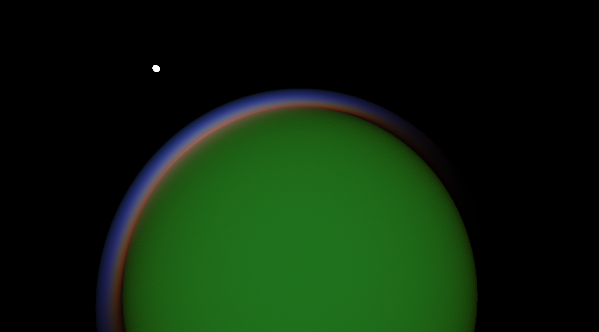
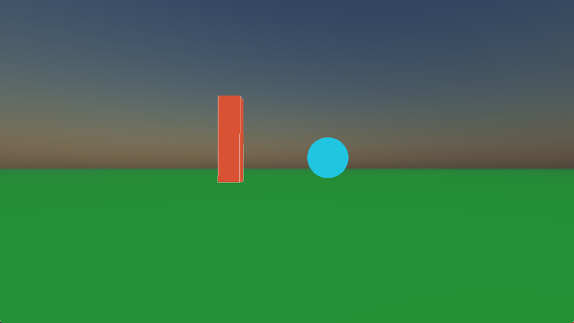
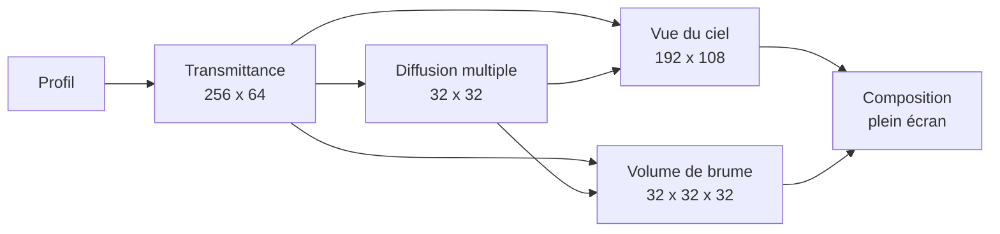

# Effet Atmospheric Scattering

**Classe :** `shimera::AtmosphericScattering`  
**En-tête :** `effects/AtmosphericScattering.hpp`  
**Profils :** `effects/profiles/AtmosphereProfile.hpp`  
**Implémentation :** `src/effects/AtmosphericScattering.cpp`  
**Shaders :** `res/shader/multi_layered/atmospheric_scattering/`

## Description

L'effet Atmospheric Scattering (diffusion atmosphérique) rend un ciel et une atmosphère physiquement réalistes par-dessus votre scène 3D : un ciel bleu, des couchers de soleil rouges et le crépuscule, un disque solaire, une brume qui s'épaissit avec la distance, et le halo lumineux d'une planète vue de l'espace. Il fonctionne depuis le sol, en l'air, depuis l'orbite, et quand la caméra traverse la limite de l'atmosphère.

Il s'appuie sur la technique de Sébastien Hillaire, [*A Scalable and Production Ready Sky and Atmosphere Rendering Technique*](https://diglib.eg.org/handle/10.1111/cgf14050) (EGSR 2020), celle du ciel d'Unreal Engine. C'est un post-traitement : il lit l'image et le **depth buffer** de votre scène, et peint l'air par-dessus. Vous n'écrivez jamais de shader : vous décrivez la planète, la caméra et le soleil depuis le C++.

Il s'utilise de trois façons :

| Mode | Réglé avec | Pour |
|------|------------|------|
| **Planète normalisée** (par défaut) | `withPlanet()` | Une planète de n'importe quelle taille dans votre monde. L'air est remis à l'échelle pour qu'une petite planète ressemble toujours à la Terre. |
| **Planète physique** | `withPhysicalPlanet()` | Une planète à l'échelle réelle, par exemple pour un simulateur de vol ou spatial. |
| **Ciel** | `withSkyMode()` | Pas de planète du tout : un ciel réaliste au-dessus d'un monde plat. |



::: warning 3D uniquement, depth buffer requis
L'effet a besoin d'une caméra en perspective et d'une texture de profondeur de la scène. Il fonctionne donc avec **`RaylibTarget`** et **`GlfwTarget`** créés avec `samplableDepth = true`. `SfmlTarget` et `SdlTarget` ne fournissent pas de texture de profondeur : avec eux, `fx.render()` lève une `std::runtime_error` indiquant que l'effet a besoin de la profondeur de la scène.
:::

## Démarrage rapide (raylib)

Un programme complet : une planète verte vue de l'orbite, avec son atmosphère.

```cpp
#include <raylib.h>
#include <shimera.hpp>
#include <hosts/RaylibTarget.hpp>

#include <iostream>

int main() {
    InitWindow(1280, 720, "Shimera - Atmospheric Scattering");
    SetTargetFPS(60);

    try {
        auto context = shimera::Context::create();
        // L'atmosphère lit la profondeur de la scène : on demande une texture de profondeur échantillonnable.
        shimera::RaylibTarget scene(1280, 720, true);
        // Pipeline HDR : le ciel est calculé en lumière, puis tone mappé à la fin.
        shimera::EffectPipeline fx(1280, 720, true);

        fx.add<shimera::AtmosphericScattering>();
        auto& sky = fx.get<shimera::AtmosphericScattering>();
        sky.withPlanet({0.0, 0.0, 0.0}, 100.0, 10.0)   // centre, rayon, épaisseur de l'air (unités du monde)
           .withSunAngles(30.0f, 150.0f)                // 30 degrés de hauteur, vers le sud-sud-est
           .withSceneLinear(false);                     // raylib dessine des couleurs 8 bits classiques
        sky.profile().heightScale = 3.0f;               // un halo plus épais, vu de l'orbite

        Camera3D camera{};
        camera.position = {0.0f, 120.0f, 260.0f};
        camera.target = {0.0f, 0.0f, 0.0f};
        camera.up = {0.0f, 1.0f, 0.0f};
        camera.fovy = 60.0f;
        camera.projection = CAMERA_PERSPECTIVE;

        while (!WindowShouldClose()) {
            scene.begin();
                ClearBackground(BLACK);
                BeginMode3D(camera);
                    DrawSphereEx({0.0f, 0.0f, 0.0f}, 100.0f, 96, 96, DARKGREEN);
                    // On lit les matrices de raylib pendant que son mode 3D est actif.
                    const shimera::Vec3<float> eye{camera.position.x, camera.position.y, camera.position.z};
                    sky.withCamera(shimera::RaylibTarget::cameraFromRaylib(eye));
                EndMode3D();
            scene.end();

            BeginDrawing();
                ClearBackground(BLACK);
                fx.render(scene);
            EndDrawing();
        }
    } catch (const std::exception& error) {
        std::cerr << error.what() << '\n';
        CloseWindow();
        return 1;
    }

    CloseWindow();
    return 0;
}
```

Trois points sont propres à cet effet :

1. **La cible hôte doit avoir une texture de profondeur** : `RaylibTarget(width, height, true)`.
2. **La caméra est donnée à chaque frame** avec `withCamera()`. Avec raylib, `RaylibTarget::cameraFromRaylib()` lit les matrices exactes de raylib, et doit être appelé entre `BeginMode3D()` et `EndMode3D()`.
3. **Dessinez votre planète au rayon donné** à `withPlanet()`, centrée là où vous l'avez indiqué.

L'exemple `examples/raylib/` du dépôt est une version complète de ce programme, avec une caméra libre, des contrôles du soleil, et le mode ciel sur la touche `M`.

## Constructeur

```cpp
explicit AtmosphericScattering(AtmosphereProfile profile = AtmospherePresets::earth());
```

Le profil décrit de quoi l'air est fait. Voir [Profils d'atmosphère](#profils-d-atmosphere).

## Paramètres

### Caméra et profondeur (à chaque frame)

| Setter | Type | Défaut | Effet |
|--------|------|--------|-------|
| `withCamera()` | `Camera` | identité | Matrices de vue et de projection, et position de la caméra avec laquelle la scène a été dessinée |
| `withDepthConvention()` | `DepthConvention` | OpenGL | Comment le depth buffer de l'hôte est encodé |

`Camera` vient de `scene/Camera.hpp`. Avec raylib, utilisez `RaylibTarget::cameraFromRaylib(eye)`. En OpenGL pur, passez vos propres matrices, en ordre colonne comme dans OpenGL et glm :

```cpp
// view et projection : shimera::Mat4, 16 floats chacune, en ordre colonne (glm::value_ptr(matrix))
sky.withCamera(shimera::Camera::fromMatrices(view, projection, eyePosition));
```

`DepthConvention` n'est à changer que si votre depth buffer n'est pas celui d'OpenGL par défaut :

| Champ | Défaut | Signification |
|-------|--------|---------------|
| `range` | `Range::NegOneToOne` | `ZeroToOne` pour une projection faite pour Vulkan, Metal ou Direct3D (ou `glClipControl`) |
| `reversed` | `false` | `true` pour un depth buffer en Z inversé (plan proche à 1, plan lointain à 0) |
| `flipY` | `false` | `true` quand les lignes de l'image sont stockées de haut en bas |

### Modes planète

| Setter | Paramètres | Effet |
|--------|------------|-------|
| `withPlanet()` | `Vec3<double> center, double radius, double atmosphereHeight` | **Mode normalisé** (par défaut). Centre, rayon et épaisseur de l'air de la planète, en unités du monde. Le profil est remis à l'échelle pour que le ciel garde son apparence à cette taille. |
| `withPhysicalPlanet()` | `Vec3<double> center, double unitsPerKilometer` | **Mode physique**. La planète a le rayon réel du profil (6360 km pour la Terre). `unitsPerKilometer` est la taille d'un kilomètre dans votre monde : `1000` pour un monde en mètres. |

Par défaut : mode normalisé, centre `(0, 0, 0)`, rayon `100`, épaisseur `3`.

### Mode ciel

| Setter | Type | Défaut | Effet |
|--------|------|--------|-------|
| `withSkyMode()` | `double seaLevel, double unitsPerKilometer` | `0.0`, `1000.0` | Passe en **mode ciel** : un ciel réaliste au-dessus d'un monde plat |
| `withWorldAxes()` | `Vec3<float> up, Vec3<float> north` | `(0, 1, 0)`, `(0, 0, -1)` | Le haut et le nord de votre monde, utilisés par le mode ciel et par `withSunAngles()` |
| `withAerialDistanceScale()` | float | `1.0` | Multiplie la distance à votre géométrie, telle que la voit la brume |
| `withVirtualGround()` | bool | `false` en mode ciel, `true` sinon | Affiche le sol de la planète invisible sous l'horizon, là où vous ne dessinez rien |

```cpp
sky.withSkyMode(0.0, 1000.0)            // niveau de la mer à y = 0, un monde en mètres
   .withSunAngles(20.0f, 270.0f)        // 20 degrés de hauteur, à l'ouest
   .withAerialDistanceScale(20.0f);     // un petit monde se fond quand même dans la brume
```

En mode ciel, une planète invisible de la taille réelle du profil est placée sous la caméra à chaque frame, avec son sol à `seaLevel` le long de l'axe vertical. Vue du sol, une planète de 6360 km est plate : elle se confond avec votre sol plat, et la caméra ne peut jamais la quitter. Votre propre sol reste le sol : la planète invisible ne coupe jamais votre géométrie.



### Soleil

| Setter / Getter | Type | Défaut | Effet |
|-----------------|------|--------|-------|
| `withSunDirection()` / `getSunDirection()` | Vec3&lt;float&gt; | `(0.3, 0.5, 0.8)` | Direction **vers** le soleil, dans l'espace du monde, normalisée en interne |
| `withSunAngles()` | float, float | aucun | Le soleil par sa hauteur et son azimut, en degrés (voir plus bas) |
| `getSunElevation()` / `getSunAzimuth()` | float | | Le soleil actuel en angles, quelle que soit la façon dont il a été réglé |
| `withSunIlluminance()` | Vec3&lt;float&gt; | `(1, 1, 1)` | Couleur et intensité de la lumière du soleil, avant d'entrer dans l'air |
| `withSunDisk()` | float, float, float | `0.545`, `1.0`, `0.6` | Rayon apparent du disque solaire en degrés, luminosité, et assombrissement du bord |

`withSunAngles(elevation, azimuth)` utilise les axes du monde de `withWorldAxes()` :

- **elevation** : `0` sur l'horizon, `90` à la verticale, négatif sous l'horizon (la nuit) ;
- **azimuth** : un cap de boussole, `0` nord, `90` est, `180` sud, `270` ouest.

Il fonctionne dans tous les modes, et le soleil garde ses angles si les axes changent ensuite. `withSunDirection()` et `withSunAngles()` se remplacent l'un l'autre : le dernier appelé l'emporte.

### Apparence et sortie

| Setter / Getter | Type | Défaut | Effet |
|-----------------|------|--------|-------|
| `withProfile()` / `getProfile()` | `AtmosphereProfile` | Terre | De quoi l'air est fait |
| `profile()` | `AtmosphereProfile&` | | Modifie le profil directement, par exemple `sky.profile().hazeAmount = 2.0f;` |
| `withExposure()` / `getExposure()` | float | `1.0` | Luminosité avant le tone mapping, **dans les pipelines LDR uniquement** |
| `withSceneLinear()` | bool | `false` | `true` si la texture de votre scène contient de la lumière linéaire (un moteur HDR), `false` pour des couleurs 8 bits classiques |
| `withOutputHdr()` | `std::optional<bool>` | `std::nullopt` | Force une sortie HDR ou d'affichage. Par défaut, suit le pipeline |

### Qualité

```cpp
shimera::AtmosphericScattering::Quality quality;
quality.skyViewSamples = 16;
quality.spaceSamples = 12;
sky.withQuality(quality);
```

| Champ | Défaut | Effet |
|-------|--------|-------|
| `transmittanceSteps` | `40` | Précision de la table d'absorption de la lumière (reconstruite seulement quand le profil change) |
| `multiScatterDirections` | `64` | Directions utilisées pour la diffusion multiple (reconstruite seulement quand le profil change) |
| `multiScatterSteps` | `20` | Pas par direction pour la diffusion multiple |
| `skyViewSamples` | `30` | Échantillons pour le ciel autour de la caméra, à chaque frame |
| `aerialSamples` | `16` | Échantillons pour la brume devant la géométrie, à chaque frame |
| `spaceSamples` | `24` | Échantillons **par pixel** quand la caméra est dans l'espace, ou pour la géométrie au-delà de la portée de la table de brume. Le coût principal depuis l'orbite |
| `referenceSamples` | `128` | Échantillons par pixel dans le mode de debug `Reference` |
| `jitter` | `true` | Décale les échantillons par pixel pour masquer les effets d'escalier |

`getQuality()` renvoie les réglages actuels.

### Vues de debug

`withDebugMode()` remplace l'image par une vue de diagnostic, et `withDebugExposure()` règle sa luminosité :

| `DebugMode` | Affiche |
|-------------|---------|
| `Off` | L'image normale (par défaut) |
| `Reference` | Une version lente, calculée pixel par pixel sans les tables. Si elle correspond à l'image normale, les tables sont justes |
| `TransmittanceLut`, `MultiScatterLut`, `SkyViewLut`, `AerialLut` | Une des quatre tables, étirée sur l'écran |
| `Altitude` | L'altitude de la surface sous chaque pixel, en bandes. Vérifie la convention de profondeur et les unités |
| `Depth` | La texture de profondeur telle que reçue. Vérifie que la cible hôte fournit bien la profondeur |

### Autres getters

| Getter | Renvoie |
|--------|---------|
| `getScaleMode()` | `ScaleMode::Normalized`, `Physical` ou `Sky` |
| `getKmPerUnit()` | Kilomètres par unité du monde, tels que les voient les shaders |
| `isCameraInsideAtmosphere()` | Si la caméra était dans l'atmosphère à la dernière frame |
| `getDebugMode()` | Le mode de debug actuel |

### Valeurs des paramètres

- **Épaisseur de `withPlanet()`** : l'air de la Terre fait 1,6 % de son rayon, un simple trait vu de l'orbite. Les planètes de jeu rendent généralement mieux avec **10 % ou plus** (rayon `100`, épaisseur `10`), plus `heightScale` (voir [Réglages artistiques](#reglages-artistiques)).
- **`withAerialDistanceScale()`** : la vraie brume demande des kilomètres d'air.
  - `1.0` - Physique : dans un monde de quelques centaines de mètres, presque pas de brume
  - `20.0` - 500 m de votre monde sont aussi brumeux que 10 km d'air
- **`withSunIlluminance()`** : `(2, 2, 2)` éclaircit le ciel à côté d'une scène sombre ou non éclairée. Une valeur légèrement chaude comme `(1.0, 0.95, 0.85)` donne une lumière du jour plus jaune.
- **`withSunDisk()`** : `0.545` degré est la taille apparente du vrai soleil ; augmentez-la pour un soleil plus gros et plus stylisé. Mettez la luminosité à `0` pour masquer le disque.

## Profils d'atmosphère

Un `AtmosphereProfile` décrit l'air sous forme de données. Trois préréglages sont fournis :

| Préréglage | Apparence |
|------------|-----------|
| `AtmospherePresets::earth()` | La Terre : ciel bleu, couchers de soleil orange et rouges (par défaut) |
| `AtmospherePresets::earthHazy()` | La Terre avec trois fois plus de brume : ciel plus pâle, halo lumineux autour du soleil |
| `AtmospherePresets::mars()` | Un air fin et poussiéreux : un ciel pâle, jaune-brun poussiéreux |

```cpp
shimera::AtmosphereProfile profile = shimera::AtmospherePresets::earth();
profile.densityScale = 2.0f;
sky.withProfile(profile);

// ou modifiez directement le profil de l'effet, à tout moment
sky.profile().hazeAmount = 1.5f;
```

Changer le profil coûte peu : l'effet repère les valeurs qui ont changé et ne reconstruit que ce qui en dépend.

### Réglages artistiques

Ils mettent à l'échelle les valeurs physiques, vous avez donc rarement besoin de toucher aux données brutes :

| Champ | Défaut | En l'augmentant, vous obtenez |
|-------|--------|-------------------------------|
| `rayleighTint` | `(1, 1, 1)` | Une autre teinte de ciel : met à l'échelle la diffusion du ciel bleu par canal (RGB) |
| `densityScale` | `1.0` | Un air plus épais : couchers de soleil plus rouges et plus sombres, horizon plus brumeux. Sous `1`, un ciel plus faible et plus sombre |
| `hazeAmount` | `1.0` | Un ciel plus blanc, un halo plus fort autour du soleil, un soleil plus terne |
| `ozoneAmount` | `1.0` | Un ciel d'un bleu plus profond au crépuscule (l'ozone absorbe la lumière verte et rouge) |
| `heightScale` | `1.0` | L'air étiré vers le haut sans en ajouter : un halo plus épais vu de l'espace, le même ciel vu du sol |
| `multiScatteringFactor` | `1.0` | La lumière qui rebondit de nombreuses fois. `0` donne des ombres et des crépuscules plus sombres, `1` est physique |
| `groundAlbedo` | `(0.3, 0.3, 0.3)` | La lumière renvoyée par le sol dans l'air |
| `aerialMaxDistanceKm` | `128.0` | La portée de la table de brume, en kilomètres du profil. Au-delà, la brume est calculée par pixel |

### Atmosphères personnalisées

Un profil contient jusqu'à **4 composants** : `kRayleigh` (gaz), `kMie` (brume), `kOzone`, et `kCustom` pour le vôtre. Chacun a une couleur de diffusion et d'absorption, en 1/km, un profil de densité qui indique comment il s'amincit avec l'altitude, et une fonction de phase qui indique dans quelles directions il diffuse la lumière :

```cpp
shimera::AtmosphereProfile alien = shimera::AtmospherePresets::earth();

// Une couche de poussière verte entre 2 et 6 km
shimera::MediumComponent& dust = alien.components[shimera::AtmosphereProfile::kCustom];
dust.scattering = {1.0e-3f, 6.0e-3f, 2.0e-3f};
dust.density[0] = shimera::DensityLayer::ramp(2.0f, 4.0f);   // monte de 2 à 4 km
dust.density[0].width = 4.0f;                                // la couche 0 s'applique sous 4 km
dust.density[1] = shimera::DensityLayer::ramp(6.0f, 4.0f);   // redescend de 4 à 6 km
dust.phase = shimera::PhaseFunction::HenyeyGreenstein;
dust.anisotropy = 0.6f;                                      // surtout vers l'avant

sky.withProfile(alien);
```

| Forme de densité | Fonction |
|------------------|----------|
| S'amincit avec la hauteur, de moitié tous les `0,7 × scaleHeight` | `DensityLayer::exponential(scaleHeightKm)` |
| Identique partout | `DensityLayer::constant(value)` |
| Linéaire, `0` à `h0` et `1` à `h1` | `DensityLayer::ramp(h0Km, h1Km)` |

| `PhaseFunction` | Diffuse la lumière |
|-----------------|--------------------|
| `Rayleigh` | Doucement, vers l'avant et vers l'arrière (molécules de gaz) |
| `CornetteShanks` | Surtout vers l'avant, le choix habituel pour la brume. Intensité réglée par `anisotropy` (`-1` à `1`) |
| `HenyeyGreenstein` | Comme `CornetteShanks`, plus doux et moins coûteux |
| `Isotropic` | De la même façon dans toutes les directions (milieux stylisés) |
| `None` | Pas du tout : le composant ne fait qu'absorber (comme l'ozone) |

## HDR et tone mapping

Le ciel est calculé en **lumière**, et le soleil est bien plus lumineux que ce qu'une image 8 bits peut contenir. L'effet gère les deux types de pipeline :

- **Pipeline HDR** (recommandé) : `EffectPipeline fx(width, height, true)`. L'effet produit des valeurs de lumière brutes, et le pipeline ajoute une étape de tone mapping à la fin : le soleil peut alors alimenter un [Bloom](./bloom.md) placé après l'atmosphère. Réglez l'exposition avec `fx.tonemap().withExposure()`.
- **Pipeline LDR** (pipeline par défaut) : l'effet applique lui-même l'exposition (`withExposure()`), une courbe ACES et l'encodage d'affichage.

Dans les deux cas, indiquez à l'effet si votre scène est en lumière linéaire ou en couleurs d'affichage classiques avec `withSceneLinear()`. Les scènes raylib, SFML et SDL dessinées avec des couleurs simples ne sont pas linéaires : gardez la valeur par défaut, `false`.

::: tip Ordre dans le pipeline
Ajoutez l'atmosphère **en premier**. Elle a besoin des couleurs et de la profondeur de votre scène telles qu'elles ont été dessinées, et les autres effets (Bloom, Vignette, ...) s'appliquent ensuite à l'image avec son ciel.
:::

## Fonctionnement

Calculer honnêtement le ciel demande de suivre la lumière à travers l'air pour chaque pixel, et pour chaque point le long du chemin, de remonter encore vers le soleil. C'est bien trop lent : l'essentiel du travail est donc calculé une fois dans quatre petites textures (des tables de correspondance), et la passe plein écran ne fait surtout que les lire :



| Table | Contient | Reconstruite |
|-------|----------|--------------|
| Transmittance | La part de lumière solaire qui survit à un trajet dans l'air, depuis n'importe quelle hauteur dans n'importe quelle direction | Quand le profil change |
| Diffusion multiple | La lumière qui a rebondi de nombreuses fois, qui remplit les ombres et le crépuscule | Quand le profil change |
| Vue du ciel | Le ciel dans toutes les directions, depuis la caméra | À chaque frame, caméra dans l'air |
| Volume de brume | La brume entre la caméra et chaque point de l'écran, à 32 distances | À chaque frame, caméra dans l'air |

La passe finale choisit ensuite, pour chaque pixel : la table de vue du ciel pour le ciel, le volume de brume pour votre géométrie, et un court calcul par pixel depuis l'espace ou au-delà de la portée de la brume. Le disque solaire est dessiné par-dessus, en pleine résolution.

## Limites

- **Hôtes 3D uniquement** : `RaylibTarget` et `GlfwTarget` avec une texture de profondeur (voir l'avertissement plus haut).
- **Vos objets ne projettent pas d'ombre dans l'air.** Seule la planète cache le soleil : il n'y a pas de rayons de lumière derrière les montagnes ou les bâtiments.
- **Votre scène n'est pas éclairée par l'effet.** Il ajoute le ciel et la brume par-dessus votre image ; éclairez vos objets vous-même, par exemple avec `getSunDirection()` pour votre lumière directionnelle.
- **Les objets transparents** qui n'écrivent pas de profondeur reçoivent la brume de ce qui se trouve derrière eux.
- **Le mode ciel est un ciel vu du sol.** En volant très haut, la courbure de la planète invisible apparaît ; utilisez un mode planète pour des vols jusqu'à l'orbite.
- **Une planète par effet.**
