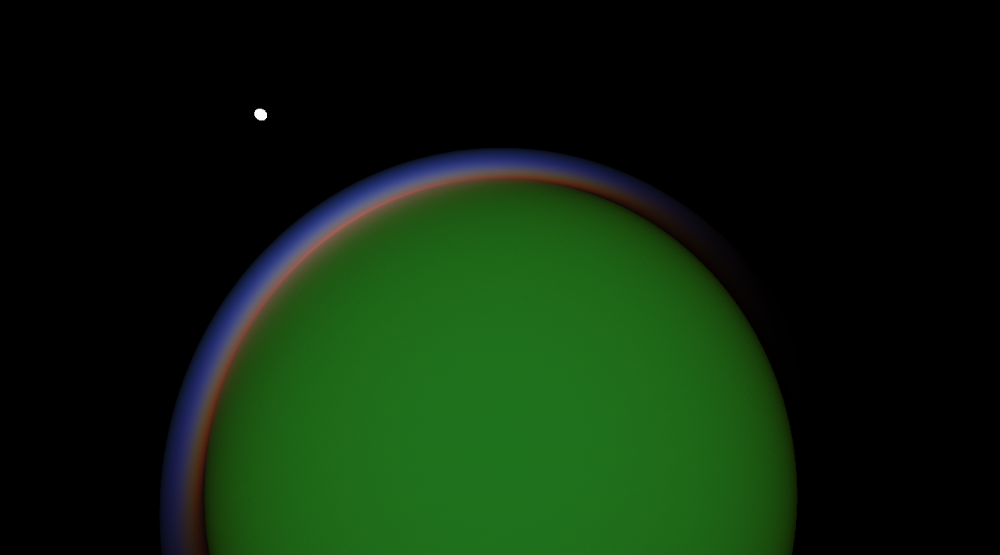
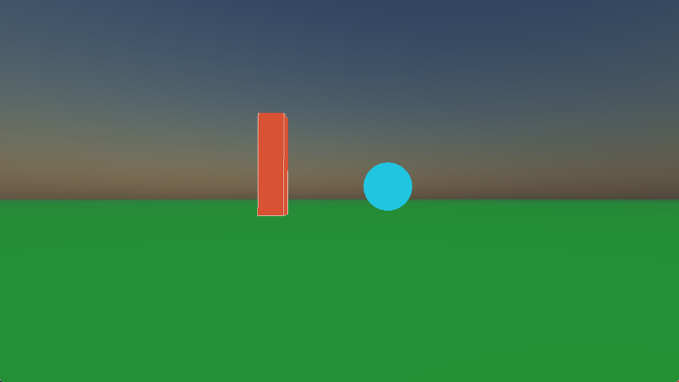
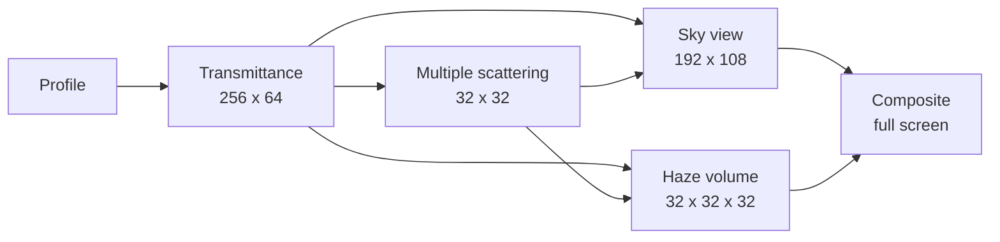

# Atmospheric Scattering Effect

**Class:** `shimera::AtmosphericScattering`  
**Header:** `effects/AtmosphericScattering.hpp`  
**Profiles:** `effects/profiles/AtmosphereProfile.hpp`  
**Implementation:** `src/effects/AtmosphericScattering.cpp`  
**Shaders:** `res/shader/multi_layered/atmospheric_scattering/`

## Description

The Atmospheric Scattering effect renders a physically based sky and atmosphere over your 3D scene. It works from the ground, in the air, from orbit, and when the camera crosses the edge of the atmosphere.

It is based on Sébastien Hillaire's technique, [*A Scalable and Production Ready Sky and Atmosphere Rendering Technique*](https://diglib.eg.org/handle/10.1111/cgf14050) (EGSR 2020), the one used by Unreal Engine's sky. It is a post-process, it reads the image and the **depth buffer** of your scene, and paints the air over them. You never write shader code, you describe the planet, the camera and the sun from C++.

It can be used in three ways:

| Mode | Set with | For |
|------|----------|-----|
| **Normalized planet** (default) | `withPlanet()` | A planet of any size in your world. The air is rescaled so a small planet still looks like Earth. |
| **Physical planet** | `withPhysicalPlanet()` | A planet at real scale, for example a flight or space simulator. |
| **Sky** | `withSkyMode()` | No planet at all, a realistic sky over a flat world. |



::: warning 3D only, depth buffer required
The effect needs a perspective camera and a depth texture of the scene, so it works with **`RaylibTarget`** and **`GlfwTarget`** created with `samplableDepth = true`. `SfmlTarget` and `SdlTarget` do not provide a depth texture: with them, `fx.render()` throws a `std::runtime_error` saying that the effect needs the scene depth.
:::

## Quick Start (raylib)

A complete program: a green planet seen from orbit, with its atmosphere.

```cpp
#include <raylib.h>
#include <shimera.hpp>
#include <hosts/RaylibTarget.hpp>

#include <iostream>

int main() {
    InitWindow(1280, 720, "Shimera - Atmospheric Scattering");
    SetTargetFPS(60);

    try {
        auto context = shimera::Context::create();
        // The atmosphere reads the scene depth: ask the target for a samplable depth texture.
        shimera::RaylibTarget scene(1280, 720, true);
        // HDR pipeline: the sky is computed as light, then tone mapped at the end.
        shimera::EffectPipeline fx(1280, 720, true);

        fx.add<shimera::AtmosphericScattering>();
        auto& sky = fx.get<shimera::AtmosphericScattering>();
        sky.withPlanet({0.0, 0.0, 0.0}, 100.0, 10.0)   // centre, radius, air thickness (world units)
           .withSunAngles(30.0f, 150.0f)                // 30 degrees up, towards south-south-east
           .withSceneLinear(false);                     // raylib draws plain 8-bit colours
        sky.profile().heightScale = 3.0f;               // a thicker halo, seen from orbit

        Camera3D camera{};
        camera.position = {0.0f, 120.0f, 260.0f};
        camera.target = {0.0f, 0.0f, 0.0f};
        camera.up = {0.0f, 1.0f, 0.0f};
        camera.fovy = 60.0f;
        camera.projection = CAMERA_PERSPECTIVE;

        while (!WindowShouldClose()) {
            scene.begin();
                ClearBackground(BLACK);
                BeginMode3D(camera);
                    DrawSphereEx({0.0f, 0.0f, 0.0f}, 100.0f, 96, 96, DARKGREEN);
                    // Read raylib's own matrices while its 3D mode is active.
                    const shimera::Vec3<float> eye{camera.position.x, camera.position.y, camera.position.z};
                    sky.withCamera(shimera::RaylibTarget::cameraFromRaylib(eye));
                EndMode3D();
            scene.end();

            BeginDrawing();
                ClearBackground(BLACK);
                fx.render(scene);
            EndDrawing();
        }
    } catch (const std::exception& error) {
        std::cerr << error.what() << '\n';
        CloseWindow();
        return 1;
    }

    CloseWindow();
    return 0;
}
```

Three things are specific to this effect:

1. **The host target must have a depth texture**: `RaylibTarget(width, height, true)`.
2. **The camera is given every frame** with `withCamera()`. With raylib, `RaylibTarget::cameraFromRaylib()` reads the exact matrices raylib uses, and must be called between `BeginMode3D()` and `EndMode3D()`.
3. **Draw your planet at the radius you gave** to `withPlanet()`, centred where you said it is.

The repository's `examples/raylib/` example is a complete version of this program, with a free camera, sun controls, and the sky mode on the `M` key.

## Constructor

```cpp
explicit AtmosphericScattering(AtmosphereProfile profile = AtmospherePresets::earth());
```

The profile describes what the air is made of. See [Atmosphere Profiles](#atmosphere-profiles).

## Parameters

### Camera and depth (every frame)

| Setter | Type | Default | Effect |
|--------|------|---------|--------|
| `withCamera()` | `Camera` | identity | View and projection matrices and eye position of the camera the scene was drawn with |
| `withDepthConvention()` | `DepthConvention` | OpenGL | How the host's depth buffer is encoded |

`Camera` comes from `scene/Camera.hpp`. With raylib, use `RaylibTarget::cameraFromRaylib(eye)`. With plain OpenGL, pass your own matrices, column-major as in OpenGL and glm:

```cpp
// view and projection: shimera::Mat4, 16 floats each, column-major (glm::value_ptr(matrix))
sky.withCamera(shimera::Camera::fromMatrices(view, projection, eyePosition));
```

`DepthConvention` only needs changing if your depth buffer is not OpenGL's default:

| Field | Default | Meaning |
|-------|---------|---------|
| `range` | `Range::NegOneToOne` | `ZeroToOne` for a projection made for Vulkan, Metal or Direct3D (or `glClipControl`) |
| `reversed` | `false` | `true` for a reversed-Z depth buffer (near plane at 1, far plane at 0) |
| `flipY` | `false` | `true` when the image's rows are stored top-down |

### Planet modes

| Setter | Parameters | Effect |
|--------|------------|--------|
| `withPlanet()` | `Vec3<double> center, double radius, double atmosphereHeight` | **Normalized mode** (default). Planet centre, radius and air thickness, in world units. The profile is rescaled so the sky keeps the profile's look at this size. |
| `withPhysicalPlanet()` | `Vec3<double> center, double unitsPerKilometer` | **Physical mode**. The planet has the profile's real radius (6360 km for Earth). `unitsPerKilometer` is the size of a kilometre in your world: `1000` for a world in metres. |

Defaults: Normalized mode, centre `(0, 0, 0)`, radius `100`, thickness `3`.

### Sky mode

| Setter | Type | Default | Effect |
|--------|------|---------|--------|
| `withSkyMode()` | `double seaLevel, double unitsPerKilometer` | `0.0`, `1000.0` | Switches to **sky mode**: a realistic sky over a flat world |
| `withWorldAxes()` | `Vec3<float> up, Vec3<float> north` | `(0, 1, 0)`, `(0, 0, -1)` | Your world's up and north, used by sky mode and by `withSunAngles()` |
| `withAerialDistanceScale()` | float | `1.0` | Multiplies the distance to your geometry, as the haze sees it |
| `withVirtualGround()` | bool | `false` in sky mode, `true` otherwise | Shows the invisible planet's ground below the horizon, where you draw nothing |

```cpp
sky.withSkyMode(0.0, 1000.0)            // sea level at y = 0, a world in metres
   .withSunAngles(20.0f, 270.0f)        // 20 degrees up, in the west
   .withAerialDistanceScale(20.0f);     // let a small world fade into the haze
```

In sky mode, an invisible planet of the profile's real size is placed under the camera every frame, with its ground at `seaLevel` along the up axis. Seen from the ground, a 6360 km planet is flat, so it matches your flat ground, and the camera can never leave it. Your own ground stays the ground: the invisible planet never cuts your geometry.



### Sun

| Setter / Getter | Type | Default | Effect |
|-----------------|------|---------|--------|
| `withSunDirection()` / `getSunDirection()` | Vec3&lt;float&gt; | `(0.3, 0.5, 0.8)` | World-space direction **towards** the sun, normalized internally |
| `withSunAngles()` | float, float | none | The sun by elevation and compass azimuth, in degrees (see below) |
| `getSunElevation()` / `getSunAzimuth()` | float | | The current sun as angles, however it was set |
| `withSunIlluminance()` | Vec3&lt;float&gt; | `(1, 1, 1)` | Color and brightness of sunlight, before it enters the air |
| `withSunDisk()` | float, float, float | `0.545`, `1.0`, `0.6` | Sun disk angular radius in degrees, brightness, and limb darkening (darker edge) |

`withSunAngles(elevation, azimuth)` uses the world axes of `withWorldAxes()`:

- **elevation**: `0` on the horizon, `90` straight overhead, negative below the horizon (night);
- **azimuth**: a compass bearing, `0` north, `90` east, `180` south, `270` west.

It works in every mode, and the sun keeps its angles if the axes change later. `withSunDirection()` and `withSunAngles()` replace each other: the last one called wins.

### Look and output

| Setter / Getter | Type | Default | Effect |
|-----------------|------|---------|--------|
| `withProfile()` / `getProfile()` | `AtmosphereProfile` | Earth | What the air is made of |
| `profile()` | `AtmosphereProfile&` | | Edit the profile in place, for example `sky.profile().hazeAmount = 2.0f;` |
| `withExposure()` / `getExposure()` | float | `1.0` | Brightness before tone mapping, **in LDR pipelines only** |
| `withSceneLinear()` | bool | `false` | `true` if your scene texture holds linear light (an HDR renderer), `false` for ordinary 8-bit colors |
| `withOutputHdr()` | `std::optional<bool>` | `std::nullopt` | Forces HDR or display output. By default, follows the pipeline |

### Quality

```cpp
shimera::AtmosphericScattering::Quality quality;
quality.skyViewSamples = 16;
quality.spaceSamples = 12;
sky.withQuality(quality);
```

| Field | Default | Effect |
|-------|---------|--------|
| `transmittanceSteps` | `40` | Accuracy of the light-absorption table (rebuilt only when the profile changes) |
| `multiScatterDirections` | `64` | Directions used for multiple scattering (rebuilt only when the profile changes) |
| `multiScatterSteps` | `20` | Steps per direction for multiple scattering |
| `skyViewSamples` | `30` | Samples for the sky around the camera, every frame |
| `aerialSamples` | `16` | Samples for the haze in front of geometry, every frame |
| `spaceSamples` | `24` | Samples **per pixel** when the camera is in space, or for geometry beyond the haze table's range. The main cost from orbit |
| `referenceSamples` | `128` | Samples per pixel in the `Reference` debug mode |
| `jitter` | `true` | Offsets the samples per pixel to hide banding |

`getQuality()` returns the current settings.

### Debug views

`withDebugMode()` replaces the image with a diagnostic view, and `withDebugExposure()` scales its brightness:

| `DebugMode` | Shows |
|-------------|-------|
| `Off` | The normal image (default) |
| `Reference` | A slow, brute-force version computed per pixel without the lookup tables. If it matches the normal image, the tables are right |
| `TransmittanceLut`, `MultiScatterLut`, `SkyViewLut`, `AerialLut` | One of the four lookup tables, stretched over the screen |
| `Altitude` | The altitude of the surface under each pixel, in bands. Checks the depth convention and the units |
| `Depth` | The depth texture as received. Checks that the host target really provides depth |

### Other getters

| Getter | Returns |
|--------|---------|
| `getScaleMode()` | `ScaleMode::Normalized`, `Physical` or `Sky` |
| `getKmPerUnit()` | Kilometres per world unit, as the shaders see it |
| `isCameraInsideAtmosphere()` | Whether the camera was inside the atmosphere on the last frame |
| `getDebugMode()` | The current debug mode |

### Parameter Values

- **`withPlanet()` thickness**: Earth's air is 1.6% of its radius, which looks like a hairline from orbit. Game planets usually look better with **10% or more** (radius `100`, thickness `10`), plus `heightScale` (see [Artistic settings](#artistic-settings)).
- **`withAerialDistanceScale()`**: real haze needs kilometres of air.
  - `1.0` - Physical: in a world a few hundred metres wide, almost no haze
  - `20.0` - 500 m of your world are as hazy as 10 km of air
- **`withSunIlluminance()`**: `(2, 2, 2)` makes the sky brighter next to an unlit or dark scene. A slightly warm value such as `(1.0, 0.95, 0.85)` gives a yellower daylight.
- **`withSunDisk()`**: `0.545` degrees is the real sun's apparent size; raise it for a bigger, more stylised sun. Set the brightness to `0` to hide the disk.

## Atmosphere Profiles

An `AtmosphereProfile` describes the air as plain data. Three presets are provided:

| Preset | Look |
|--------|------|
| `AtmospherePresets::earth()` | Earth: blue sky, orange and red sunsets (default) |
| `AtmospherePresets::earthHazy()` | Earth with three times more haze: paler sky, bright glow around the sun |
| `AtmospherePresets::mars()` | A thin, dusty air: a pale, dusty yellow-brown sky |

```cpp
shimera::AtmosphereProfile profile = shimera::AtmospherePresets::earth();
profile.densityScale = 2.0f;
sky.withProfile(profile);

// or edit the effect's profile in place, at any time
sky.profile().hazeAmount = 1.5f;
```

Changing the profile is cheap: the effect notices which values changed and only rebuilds what depends on them.

### Artistic settings

These scale the physical values, so you rarely need to touch the raw data:

| Field | Default | Turn it up and you get |
|-------|---------|------------------------|
| `rayleighTint` | `(1, 1, 1)` | A different sky hue: scales the blue-sky scattering per channel (RGB) |
| `densityScale` | `1.0` | Thicker air: redder and darker sunsets, hazier horizon. Below `1`, a fainter, darker sky |
| `hazeAmount` | `1.0` | Whiter sky, brighter glow around the sun, dimmer sun |
| `ozoneAmount` | `1.0` | A deeper blue sky at twilight (ozone absorbs green and red light) |
| `heightScale` | `1.0` | Air stretched upwards without adding any: a thicker halo from space, the same sky from the ground |
| `multiScatteringFactor` | `1.0` | Light bounced many times. `0` gives darker shadows and twilights, `1` is physical |
| `groundAlbedo` | `(0.3, 0.3, 0.3)` | Light reflected by the ground back into the air |
| `aerialMaxDistanceKm` | `128.0` | How far the haze table reaches, in the profile's kilometres. Beyond it, haze is computed per pixel |

### Custom atmospheres

A profile holds up to **4 components**: `kRayleigh` (gas), `kMie` (haze), `kOzone`, and `kCustom` for your own. Each has a scattering and an absorption color, in 1/km, a density profile saying how it thins with altitude, and a phase function saying in which directions it scatters light:

```cpp
shimera::AtmosphereProfile alien = shimera::AtmospherePresets::earth();

// A layer of green dust between 2 and 6 km
shimera::MediumComponent& dust = alien.components[shimera::AtmosphereProfile::kCustom];
dust.scattering = {1.0e-3f, 6.0e-3f, 2.0e-3f};
dust.density[0] = shimera::DensityLayer::ramp(2.0f, 4.0f);   // rises from 2 to 4 km
dust.density[0].width = 4.0f;                                // layer 0 applies below 4 km
dust.density[1] = shimera::DensityLayer::ramp(6.0f, 4.0f);   // falls from 4 to 6 km
dust.phase = shimera::PhaseFunction::HenyeyGreenstein;
dust.anisotropy = 0.6f;                                      // mostly forward

sky.withProfile(alien);
```

| Density shape | Helper |
|---------------|--------|
| Thins out with height, halving every `0.7 × scaleHeight` | `DensityLayer::exponential(scaleHeightKm)` |
| Same everywhere | `DensityLayer::constant(value)` |
| Linear, `0` at `h0` and `1` at `h1` | `DensityLayer::ramp(h0Km, h1Km)` |

| `PhaseFunction` | Scatters light |
|-----------------|----------------|
| `Rayleigh` | Gently, forward and backward (gas molecules) |
| `CornetteShanks` | Mostly forward, the usual choice for haze. Strength set by `anisotropy` (`-1` to `1`) |
| `HenyeyGreenstein` | Like `CornetteShanks`, softer and cheaper |
| `Isotropic` | Equally in all directions (stylised media) |
| `None` | Not at all: the component only absorbs (like ozone) |

## HDR and Tone Mapping

The sky is computed as **light**, and the sun is far brighter than anything an 8-bit image can hold. The effect handles both kinds of pipeline:

- **HDR pipeline** (recommended): `EffectPipeline fx(width, height, true)`. The effect outputs raw light values, and the pipeline adds a tone mapping step at the end, so the sun can feed a [Bloom](./bloom.md) placed after the atmosphere. Adjust the exposure with `fx.tonemap().withExposure()`.
- **LDR pipeline** (default pipeline): the effect applies exposure (`withExposure()`), an ACES tone curve and the display encoding itself.

In both cases, tell the effect whether your scene is linear light or ordinary display colors with `withSceneLinear()`. raylib, SFML and SDL scenes drawn with plain colors are not linear: keep the default `false`.

::: tip Order in the pipeline
Add the atmosphere **first**. It needs your scene's colors and depth as they were drawn, and the other effects (Bloom, Vignette, ...) then apply to the image with its sky.
:::

## How It Works

Computing the sky honestly means following light through the air for every pixel, and for every point along the way, towards the sun again. That is far too slow, so most of the work is computed once into four small textures (lookup tables), and the full-screen pass mostly reads them:



| Table | Holds | Rebuilt |
|-------|-------|---------|
| Transmittance | How much sunlight survives a trip through the air, from any height in any direction | When the profile changes |
| Multiple scattering | The light bounced many times, which fills shadows and twilight | When the profile changes |
| Sky view | The sky in every direction, from the camera | Every frame, camera inside the air |
| Haze volume | The haze between the camera and any point on screen, at 32 distances | Every frame, camera inside the air |

The final pass then chooses, per pixel: the sky-view table for the sky, the haze volume for your geometry, and a short per-pixel computation from space or beyond the haze range. The sun disk is drawn at full resolution on top.

## Limitations

- **3D hosts only**: `RaylibTarget` and `GlfwTarget` with a depth texture (see the warning above).
- **Your objects do not cast shadows into the air.** Only the planet blocks the sun: there are no light shafts behind mountains or buildings.
- **Your scene is not lit by the effect.** It adds sky and haze over your image; light your objects yourself, for example using `getSunDirection()` for your directional light.
- **Transparent objects** that do not write depth get the haze of what is behind them.
- **Sky mode is a ground-level sky.** Flying very high reveals the curvature of the invisible planet; use a planet mode for flights to orbit.
- **One planet per effect.**
